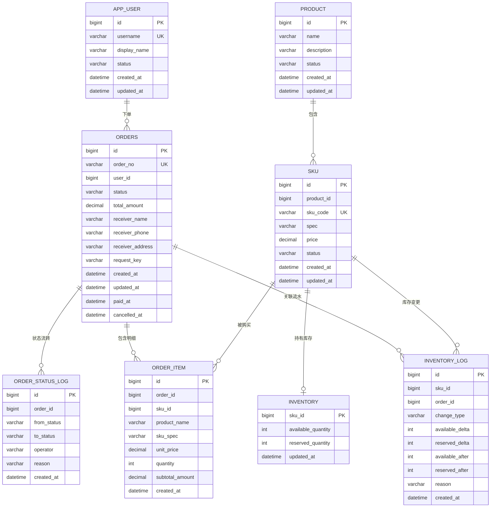

# 数据库设计（第一阶段）

第一阶段使用 MySQL 8.4 + InnoDB，数据库名 `commerce`。表结构由 Flyway 的 [V1__init_schema.sql](../src/main/resources/db/migration/V1__init_schema.sql) 建立；开发数据由 [R__dev_seed.sql](../src/main/resources/db/seed/R__dev_seed.sql) 单独加载。本文记录实体关系、约束和口径，避免实现阶段靠记忆修改表结构。

## 1. ER 图



## 2. 表与关系

| 表 | 归属模块 | 作用 |
| --- | --- | --- |
| `app_user` | user | 用户；第一阶段由开发接口模拟身份 |
| `product` | product | 商品（SPU），只描述共性信息与上下架状态 |
| `sku` | product | 可售单元，库存、价格和订单都落到 SKU |
| `inventory` | inventory | 每个 SKU 一行的可用库存与预占库存 |
| `inventory_log` | inventory | 库存变更流水，记录变更量和变更后余额 |
| `orders` | order | 订单主表，含请求键、收货信息快照和状态时间 |
| `order_item` | order | 订单明细，含商品名、规格、成交单价快照 |
| `order_status_log` | order | 订单状态变更日志 |

| 关系 | 基数 | 说明 |
| --- | --- | --- |
| `app_user` → `orders` | 1 : N | 订单归属用户；查询与操作必须校验归属 |
| `product` → `sku` | 1 : N | 商品可以有多个 SKU；库存和价格在 SKU 上 |
| `sku` → `inventory` | 1 : 1 | 主键即 `sku_id`，一个 SKU 只有一行库存 |
| `sku` → `order_item` | 1 : N | 明细引用 SKU，同时保存快照 |
| `orders` → `order_item` | 1 : N | 同一订单内不允许重复 SKU |
| `orders` → `order_status_log` | 1 : N | 每次状态流转追加一条日志 |
| `sku` → `inventory_log` | 1 : N | 初始化、预占、核销、释放、调整都写流水 |
| `orders` → `inventory_log` | 1 : N | 流水可关联订单；初始化和人工调整时 `order_id` 为空 |

## 3. 主键与外键策略

**主键**：所有表使用 `BIGINT UNSIGNED AUTO_INCREMENT`。单实例 MySQL 下自增主键写入集中、二级索引体积小；第一阶段不需要分布式 ID。接口层可以使用订单号 `order_no` 对外暴露，不直接依赖自增 ID 的可猜测性。开发数据固定占用 1～5，业务测试不要复用这些 ID。

**外键**：不建立物理外键。原因：

- 订单、库存和流水是高频写入路径，物理外键会在父行上引入额外共享锁，扩大死锁与锁等待范围。
- 迁移和批量维护时，物理外键会让删除/重建顺序复杂化。
- 第一阶段的关联完整性由服务层事务、唯一约束和自动化测试保证；所有关联列都建了索引，避免关联查询退化为全表扫描。

代价是数据库不会阻止孤儿行。第 7 步的集成测试要覆盖“明细必须属于订单”“库存流水必须对应 SKU”等不变量；若后续引入物理外键，需要单独版本迁移并评估锁影响。

**删除策略**：商品下架用 `status = 'OFF_SALE'`，不做物理删除；SKU、订单、明细、流水和状态日志都保留历史。删除用户不在第一阶段范围。

## 4. 唯一约束与幂等

| 约束 | 位置 | 作用 |
| --- | --- | --- |
| `uk_app_user_username` | `app_user.username` | 用户名唯一；排序规则不区分大小写，`Alice` 与 `alice` 视为同一个 |
| `uk_sku_code` | `sku.sku_code` | SKU 编码全局唯一 |
| `uk_orders_order_no` | `orders.order_no` | 订单号唯一，便于对外查询 |
| `uk_orders_user_request` | `orders(user_id, request_key)` | 创建订单的用户级幂等键；同键重复提交不会产生第二张订单 |
| `uk_order_item_order_sku` | `order_item(order_id, sku_id)` | 同一订单不允许重复 SKU，重复请求在数据库层也会被拒绝 |
| `PRIMARY` | `inventory.sku_id` | 每个 SKU 只有一行库存 |

`request_key` 为 `NOT NULL`：创建订单接口必须携带请求键。相同键、相同内容返回原订单；相同键、不同内容由服务层拒绝。唯一约束是幂等的最后防线，不能只靠先查询再插入。

## 5. 索引

| 索引 | 目的 |
| --- | --- |
| `idx_product_status` | 按上下架状态筛选商品列表 |
| `idx_sku_product` | 商品详情列出所属 SKU |
| `idx_inventory_log_sku(sku_id, id)` | 某 SKU 的流水时间线（`id` 递增近似时间顺序） |
| `idx_inventory_log_order` | 按订单核对库存变更 |
| `idx_orders_user_created(user_id, created_at)` | 用户订单列表按时间倒序 |
| `idx_orders_status_created(status, created_at)` | 未支付订单扫描、运营统计；第二阶段超时取消会用到 |
| `idx_order_item_sku` | 按 SKU 统计销量、排查订单 |
| `idx_order_status_log_order(order_id, id)` | 订单状态时间线 |

索引原则是“先有查询再有索引”。第一阶段业务接口确定后，第 7 步用真实查询复核执行计划，避免只凭猜测增加索引。

## 6. 金额口径

- 价格、小计和总额统一使用 `DECIMAL`，禁止 `FLOAT`/`DOUBLE`。浮点数会出现 `0.1 + 0.2 != 0.3` 之类的二进制误差。
- `sku.price`、`order_item.unit_price` 使用 `DECIMAL(12,2)`；`order_item.subtotal_amount`、`orders.total_amount` 使用 `DECIMAL(14,2)`，为“单价 × 数量”预留位数。
- Java 侧使用 `BigDecimal`，在服务端计算 `unit_price × quantity` 与订单总额，不信任客户端传入金额。
- 金额单位是元，保留两位小数。第一阶段不做多币种和税率；若引入折扣，新增字段并重新定义四舍五入规则，不能直接改已执行迁移。

## 7. 时间口径

- 所有时间列使用 `DATETIME(3)`，精度到毫秒；不使用 `TIMESTAMP`，避免 2038 问题和服务端隐式时区转换。
- 数据库时区固定为 UTC：容器参数 `--default-time-zone=+00:00`，JDBC URL 使用 `connectionTimeZone=UTC&forceConnectionTimeZoneToSession=true`。`created_at` 等默认值因此也是 UTC。
- `created_at` 由默认值写入；`updated_at` 在更新时自动刷新。业务时间（`paid_at`、`cancelled_at`）由服务层在同一事务内写入。
- 接口输出使用带 `Z` 的 ISO-8601 时间；边界转换集中在一处，避免每个接口各自处理时区。
- 服务器和数据库时钟必须同步；时间比较（例如第二阶段超时取消）以数据库时间为准，避免应用节点时钟漂移。

## 8. 字符集、存储引擎与隔离级别

- 字符集 `utf8mb4`，排序规则 `utf8mb4_0900_ai_ci`，支持中文和 emoji；用户名和 SKU 编码的唯一性按不区分大小写判断。
- 存储引擎 InnoDB，使用行锁和事务。
- 隔离级别沿用 MySQL 默认的 `REPEATABLE-READ`。防超卖依赖“条件 UPDATE + 影响行数判断”，不依赖可重复读的间隙锁；第 6 步要用并发测试证明。
- 开启 `STRICT_TRANS_TABLES` 等严格模式，超长、越界和非法值直接报错，不做静默截断。

## 9. 状态与流水类型

| 字段 | 取值 | 含义 |
| --- | --- | --- |
| `app_user.status` | `ACTIVE` / `DISABLED` | 可登录 / 已停用 |
| `product.status` | `DRAFT` / `ON_SALE` / `OFF_SALE` | 草稿 / 在售 / 下架 |
| `sku.status` | `ON_SALE` / `OFF_SALE` | 该 SKU 是否可售 |
| `orders.status` | `PENDING_PAYMENT` / `PAID` / `CANCELLED` | 待支付 / 已支付 / 已取消 |
| `inventory_log.change_type` | `INIT` / `RESERVE` / `CONFIRM` / `RELEASE` / `ADJUST` | 初始化 / 预占 / 支付核销 / 取消释放 / 人工调整 |

`order_status_log.from_status` 允许为空，表示第一条创建日志（无前置状态）。状态值同时受 `CHECK` 约束和服务层枚举控制，数据库负责拒绝拼写错误。

库存流水的 `available_delta` 与 `reserved_delta` 是有符号变更量：

| 类型 | `available_delta` | `reserved_delta` | 场景 |
| --- | --- | --- | --- |
| `INIT` | 正数 | 0 | 开发数据或首次建库存 |
| `RESERVE` | -数量 | +数量 | 创建订单时预占 |
| `CONFIRM` | 0 | -数量 | 支付成功，核销预占 |
| `RELEASE` | +数量 | -数量 | 取消订单，释放预占 |
| `ADJUST` | 正负均可 | 0 | 人工补货或盘点 |

`available_after`、`reserved_after` 保存变更后的余额，便于核对，也让流水本身能回答“变更前是多少”。

## 10. 快照与不可变性

- `order_item` 保存 `product_name`、`sku_spec`、`unit_price`。商品改名、改价或下架不会改变历史订单的展示与金额；订单查询不依赖当前商品数据。
- `orders` 保存 `receiver_name`、`receiver_phone`、`receiver_address`，不引用可变的用户地址表（第一阶段也没有地址表）。
- `orders.total_amount` 是下单时的成交总额；明细小计之和必须等于总额。
- `inventory_log` 是追加日志，不更新、不删除；库存调整通过新增流水完成，便于审计。

## 11. 一致性核对 SQL

以下查询在业务验收和排障时使用；返回空结果表示一致。不要在业务高峰执行大范围扫描。

```sql
-- 1. 每个 SKU 的最新流水余额应与库存表一致
SELECT i.sku_id, i.available_quantity, i.reserved_quantity,
       l.available_after, l.reserved_after
FROM inventory i
JOIN inventory_log l
  ON l.sku_id = i.sku_id
 AND l.id = (SELECT MAX(id) FROM inventory_log WHERE sku_id = i.sku_id)
WHERE i.available_quantity <> l.available_after
   OR i.reserved_quantity <> l.reserved_after;

-- 2. 订单总额应等于明细小计之和
SELECT o.id, o.order_no, o.total_amount, SUM(oi.subtotal_amount) AS item_sum
FROM orders o
JOIN order_item oi ON oi.order_id = o.id
GROUP BY o.id, o.order_no, o.total_amount
HAVING o.total_amount <> SUM(oi.subtotal_amount);

-- 3. 明细小计应等于单价 × 数量
SELECT id, order_id, sku_id, unit_price, quantity, subtotal_amount
FROM order_item
WHERE subtotal_amount <> unit_price * quantity;
```

## 12. Flyway 与开发数据

- `src/main/resources/db/migration/` 只放按版本追加的结构迁移，文件名格式 `V<版本>__<说明>.sql`。
- `src/main/resources/db/seed/` 只放开发数据，文件名为可重复迁移 `R__dev_seed.sql`，仅在 `local` profile 的 `spring.flyway.locations` 中加载。
- 已执行的迁移文件不能修改，否则 Flyway 校验和会失败；结构变更必须新增 `V2__*.sql`。
- `baseline-on-migrate=false`：新库从 V1 开始执行，已有库不会被悄悄基线化。
- `clean-disabled=true`：禁止通过 Flyway 清库，删除数据必须走独立、明确的破坏性操作。
- `placeholder-replacement=false`：SQL 中的 `${...}` 不会被 Flyway 当作占位符替换。
- 开发数据使用固定主键和 `INSERT IGNORE`，重复执行只补缺失行，不覆盖本地已修改的数据；连续执行两次行数不变。
- 应用不直接执行建表 SQL，迁移由 Flyway 在启动时完成；第 5 步验证空库首次迁移与已有库增量升级，第 7 步用集成测试覆盖数据库行为。

Flyway 需要的表级权限：`CREATE`、`ALTER`、`DROP`、`INDEX`、`REFERENCES`（DDL），以及 `SELECT`、`INSERT`、`UPDATE`、`DELETE`（DML 与 `flyway_schema_history`）。本项目的应用账号只有 `commerce` 库上的全部权限和全局 `USAGE`，没有 `SUPER`、`GRANT`、`CREATE USER` 或 `FILE`。

## 13. 本步未覆盖

- 订单超时自动取消（第二阶段，配合定时任务或消息队列）。
- 物理外键、分库分表、读写分离（第一阶段不引入）。
- 商品图片、类目、优惠券、退款、地址簿等扩展表。
- MyBatis-Plus 与 Mapper 实现，随第 6 步业务接口落地。
